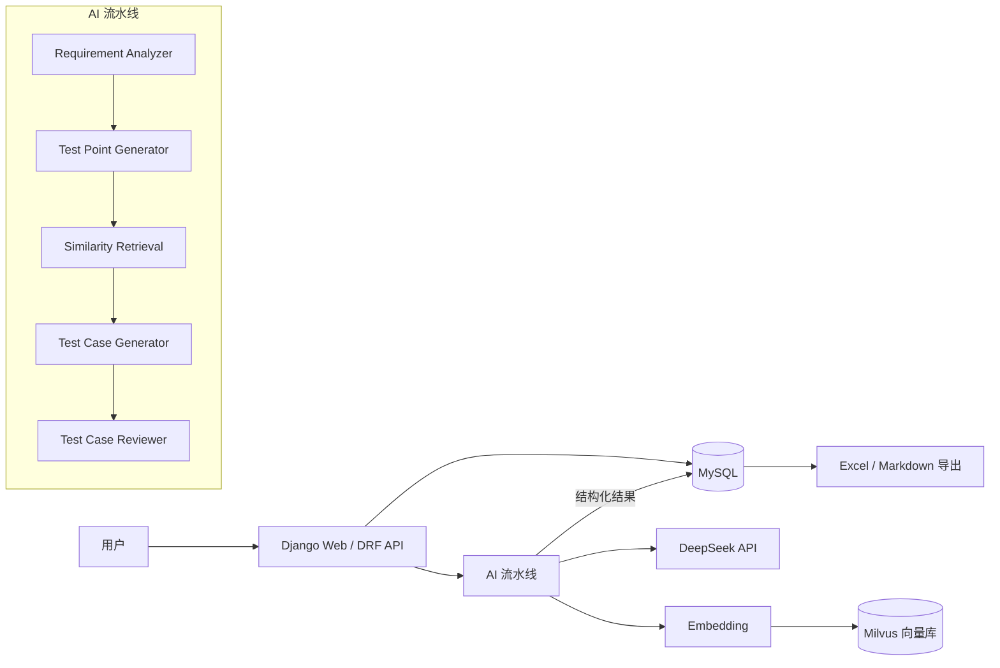
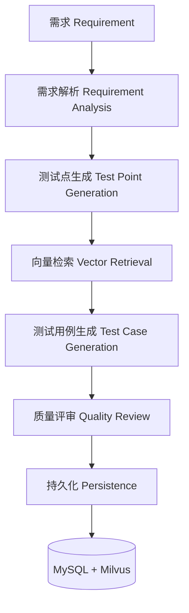

# TestFlow · AI 智能测试用例生成平台

一个用于软件测试场景的 AI Web 应用：用户输入软件功能需求，系统通过大语言模型（DeepSeek）分析需求、提取测试点，并按软件测试方法生成结构化测试用例，最后支持质量检查、向量相似检索与 Excel / Markdown 导出。

> 项目定位：软件测试 / 测试开发岗位求职展示，重点体现软件测试方法、AI 应用、REST API、数据库与工程化能力。

---

## 项目介绍

传统测试用例编写依赖人工逐条梳理，效率低且容易遗漏边界与异常场景。TestFlow 将 LLM 引入测试用例生成流程，并做如下设计：

1. **分阶段生成，而非一次性生成**：需求解析 → 测试点设计 → 测试用例生成 → 质量评审，每一阶段都输出结构化 JSON，便于校验与调试。
2. **质量评审闭环**：生成后由 Reviewer 从覆盖性、遗漏场景、重复用例、可执行性等维度做辅助检查。
3. **向量相似检索**：将历史用例向量化写入 Milvus，生成新用例前检索 Top-K 相似历史用例作为参考（Few-shot 上下文）。
4. **可降级设计**：Milvus 或向量库不可用时，核心 AI 生成流程仍可正常运行；MySQL 保存完整业务数据，向量库只负责语义检索。

---

## 功能特性

- **需求管理**：创建需求、输入标题 / 模块 / 详细描述，查看历史需求与详情。
- **AI 需求解析**：提取功能点、输入字段、输入约束、业务规则、状态变化、异常 / 边界 / 前置条件，并标注不确定信息（不编造）。
- **测试点生成**：覆盖功能 / 异常 / 边界 / 输入校验 / 状态 / 权限 / 数据一致性 / 安全 / 性能 / 兼容 / 可用性等维度，由 AI 自主判断哪些维度真正适用（不强行凑分类），并标注优先级（P0/P1/P2）与设计方法。
- **测试点交互管理**：按分类分组展示，支持勾选 / 全选 / 取消全选、编辑 / 删除 / 新增，实时统计「已选择 X / Y 个测试点」。
- **按测试点生成用例**：原始需求 + 已选测试点交给 AI，生成详细用例并关联回对应测试点（TP → TC）。
- **测试用例生成**：输出结构化用例（case_id、module、title、preconditions、steps、test_data、expected_result、test_type、priority、design_method）。
- **AI 质量检查（Reviewer）**：输出 coverage_issues、missing_scenarios、duplicate_candidates、ambiguous_cases、suggestions。
- **Milvus 相似用例检索**：Top-K 语义检索，作为 LLM 参考与相似场景识别。
- **筛选与导出**：按类型 / 优先级 / 设计方法筛选；导出 Excel / Markdown。
- **统一 API**：Django REST Framework + 统一响应结构与错误处理。

---

## 系统架构



- **MySQL**：保存完整业务数据（需求、测试点、测试用例、生成记录）。
- **Milvus**：只保存向量 + 少量索引字段（testcase_id / requirement_id），用于语义相似度搜索。
- **DeepSeek**：通过 OpenAI 兼容接口 + LangChain 调用，负责需求分析、测试点 / 用例生成与评审。

---

## 技术栈

| 层次 | 技术 |
| --- | --- |
| 后端框架 | Python 3 / Django 5.2 / Django REST Framework |
| 数据库 | MySQL 8（Django ORM） |
| AI | DeepSeek API / LangChain / Pydantic（结构化输出约束） |
| 向量检索 | Milvus（pymilvus），内置内存向量库兜底 |
| Embedding | 内置字符 n-gram 哈希向量（离线可用），可切换 sentence-transformers |
| 前端 | Django Template + Bootstrap 5（少量原生 JS） |
| 导出 | pandas / openpyxl |
| 配置 | python-dotenv（`.env`） |
| 测试 | pytest / pytest-django |

---

## 项目目录

```
TestFlow/
├── manage.py
├── config/                 # Django 项目配置
│   ├── settings.py         # 主配置（读取 .env）
│   ├── settings_test.py    # 测试配置（SQLite 内存库）
│   └── urls.py
├── requirements/           # 需求应用（Requirement 模型 + CRUD + Web 页面）
├── testcases/              # 测试用例应用（TestPoint/TestCase/GenerationRecord + 生成服务 + API）
│   └── management/commands/rebuild_index.py   # 重建向量索引命令
├── ai/                     # AI 层（与 Django 模型解耦，可独立测试）
│   ├── services/           # Analyzer / TestPoint / TestCase / Reviewer / 流水线编排
│   ├── prompts/            # 各阶段 Prompt（独立管理）
│   └── schemas/            # Pydantic 结构化输出 Schema
├── core/                   # 公共层：LLM 客户端 / Embedding / 导出 / 异常与响应
├── vectorstore/            # 向量库抽象：Milvus 实现 + 内存降级实现
├── templates/              # Django 模板
├── static/                 # 前端 JS / CSS
├── tests/                  # 自动化测试
├── requirements.txt
├── docker-compose.yml      # MySQL + Milvus
├── .env.example            # 环境变量样例（真实凭据请写入 .env，勿提交）
└── README.md
```

---

## 环境要求

- Python 3.11+
- MySQL 8.0（或使用 `DB_ENGINE=sqlite` 快速体验）
- （可选）Docker + Docker Compose（用于启动 Milvus）
- 一个 DeepSeek API Key

---

## 安装步骤

```bash
# 1. 克隆 / 进入项目
cd TestFlow

# 2. 创建并激活虚拟环境
python -m venv .venv
source .venv/bin/activate        # Windows: .venv\Scripts\activate

# 3. 安装依赖
pip install -r requirements.txt

# 4. 配置环境变量（复制样例并填写）
cp .env.example .env
```

---

## MySQL 配置

**方式 A：本机已有 MySQL（推荐）**

1. 创建数据库与账号：

```sql
CREATE DATABASE testflow CHARACTER SET utf8mb4 COLLATE utf8mb4_unicode_ci;
-- 或直接使用 root 账号
```

2. 在 `.env` 中填写：

```ini
DB_ENGINE=mysql
DB_NAME=testflow
DB_USER=root
DB_PASSWORD=你的密码
DB_HOST=127.0.0.1
DB_PORT=3306
```

**方式 B：用 Docker 启动 MySQL**

```bash
docker compose up -d mysql
# 默认账号：testflow / testflow，数据库：testflow
```

> 若暂时没有 MySQL，可将 `.env` 中 `DB_ENGINE=sqlite`，项目会使用本地 `db.sqlite3` 快速运行（仅用于体验）。

---

## Milvus 配置

Milvus 为**可选**组件：不启用时，系统会自动降级到内置内存向量库，核心生成流程不受影响。

```bash
docker compose up -d etcd minio milvus
```

在 `.env` 中开启：

```ini
MILVUS_ENABLED=true
MILVUS_HOST=localhost
MILVUS_PORT=19530
MILVUS_COLLECTION=testcase_vectors
```

> 需要安装可选依赖 `pip install pymilvus` 后才能连接 Milvus。

---

## DeepSeek API 配置

1. 前往 [DeepSeek 开放平台](https://platform.deepseek.com) 申请 API Key。
2. 在 `.env` 中填写：

```ini
DEEPSEEK_API_KEY=sk-xxxxxx
DEEPSEEK_BASE_URL=https://api.deepseek.com/v1
DEEPSEEK_MODEL=deepseek-v4-pro
```

模型名可在平台按实际情况调整（如 `deepseek-chat`、`deepseek-v4-pro`、`deepseek-flash` 等）。

---

## .env 配置

完整配置项见 [`.env.example`](.env.example)。要点：

| 变量 | 说明 |
| --- | --- |
| `DB_ENGINE` | `mysql` 或 `sqlite` |
| `DEEPSEEK_API_KEY` | 必填，DeepSeek API Key |
| `DEEPSEEK_MODEL` | 模型名，默认 `deepseek-v4-pro` |
| `EMBEDDING_PROVIDER` | `hash`（默认）或 `sentence_transformers` |
| `MILVUS_ENABLED` | `true` / `false`，控制是否使用 Milvus |

> 敏感信息（API Key、数据库密码）只放在 `.env`，该文件已被 `.gitignore` 排除，不要提交到 Git。

---

## 数据库 Migration

```bash
python manage.py makemigrations   # 首次或模型变更时
python manage.py migrate          # 应用迁移
```

---

## 项目启动

```bash
python manage.py runserver
```

访问：

- 首页：<http://127.0.0.1:8000/>
- 新建需求：<http://127.0.0.1:8000/requirements/new/>
- 管理后台：<http://127.0.0.1:8000/admin/>（可选，需先 `python manage.py createsuperuser`）

可选：重建向量索引（切换 Embedding / 向量库后回填历史用例）

```bash
python manage.py rebuild_index
```

---

## 自动化测试

测试使用 SQLite 内存库，**Mock 掉 DeepSeek API**，无需真实 Key 与外部服务即可运行：

```bash
pytest
```

测试覆盖：

- **API**：需求创建 / 查询 / 详情、生成接口基本流程、参数校验、异常请求（404 / 503）。
- **Service**：结构化 LLM 输出解析、测试用例保存、Reviewer 结果解析、Milvus 不可用时的降级逻辑。
- **工具**：LLM JSON 提取、Excel / Markdown 导出、向量检索。

---

## API 示例

统一响应结构：

```json
// 成功
{"code": 0, "message": "ok", "data": { ... }}
// 失败（code 为 HTTP 状态码）
{"code": 404, "message": "需求不存在", "data": null}
```

主要接口（`id` 为需求 ID）：

```bash
# 创建需求
curl -X POST http://127.0.0.1:8000/api/requirements/ \
  -H "Content-Type: application/json" \
  -d '{"title":"用户登录","module":"登录模块","description":"用户使用手机号和密码登录……"}'

# 需求列表 / 详情
curl http://127.0.0.1:8000/api/requirements/
curl http://127.0.0.1:8000/api/requirements/1/

# 触发 AI 生成测试用例（一次性全流程）
curl -X POST http://127.0.0.1:8000/api/requirements/1/generate/

# 只生成测试点（需求 → 测试点）
curl -X POST http://127.0.0.1:8000/api/requirements/1/testpoints/generate/

# 测试点列表 / 新增 / 编辑(勾选) / 删除 / 全选
curl http://127.0.0.1:8000/api/requirements/1/testpoints/
curl -X POST http://127.0.0.1:8000/api/requirements/1/testpoints/ -H "Content-Type: application/json" -d '{"title":"验证码错误提示","category":"exception","priority":"P1"}'
curl -X PATCH http://127.0.0.1:8000/api/requirements/1/testpoints/5/ -H "Content-Type: application/json" -d '{"selected":false}'
curl -X DELETE http://127.0.0.1:8000/api/requirements/1/testpoints/5/
curl -X POST http://127.0.0.1:8000/api/requirements/1/testpoints/select/ -H "Content-Type: application/json" -d '{"selected":true}'

# 根据已选测试点生成测试用例（测试点 → 测试用例；body 省略则用全部已选）
curl -X POST http://127.0.0.1:8000/api/requirements/1/testcases/generate/ -H "Content-Type: application/json" -d '{"test_point_ids":[1,2,3]}'

# 测试用例（支持 test_type / priority / design_method 筛选）
curl "http://127.0.0.1:8000/api/requirements/1/testcases/?priority=P0"

# 质量检查 / 相似用例
curl http://127.0.0.1:8000/api/requirements/1/review/
curl http://127.0.0.1:8000/api/requirements/1/similar/

# 导出
curl -OJ http://127.0.0.1:8000/api/requirements/1/export/excel/
curl -OJ http://127.0.0.1:8000/api/requirements/1/export/markdown/
```

---

## 项目截图

（截图占位，待补充：首页 Dashboard、需求详情 + 测试用例表格、质量检查结果、相似用例展示。）

---

## AI 测试用例生成流程



提供两种生成入口：

1. **直接生成测试用例**：一次跑完整条流水线（解析 → 测试点 → 用例 → 评审），测试点作为中间产物一并落库。
2. **两步式**：先「生成测试点」，在测试点 Tab 勾选 / 编辑后，再「根据已选测试点生成测试用例」——用例生成时只复用已选测试点，不再重新解析需求。

---

## Milvus 检索原理

- **Embedding（向量化）**：把一段文本（如用例标题 + 步骤 + 预期结果）通过模型映射为固定维度的浮点数向量，语义相近的文本向量在空间中距离更近。
- **Semantic Search（语义检索）**：将当前需求的向量与历史用例向量计算相似度（本项目使用余弦相似度），返回 Top-K 最相似的历史用例。
- **分工**：MySQL 保存完整业务数据；Milvus 只保存向量与少量索引字段，通过 `testcase_id` 关联回 MySQL 取完整用例。

> 本项目默认使用内置的字符 n-gram 哈希向量（离线可用、确定性），不是真实语义模型；如需真实语义向量，可将 `EMBEDDING_PROVIDER=sentence_transformers` 并安装 `sentence-transformers`。

---

## 项目限制

- AI 生成的测试用例**不能保证完全覆盖需求**，输出仍需测试人员 Review。
- 内置哈希向量仅为轻量相似度近似，不能替代真实语义 Embedding 模型。
- 本项目为无鉴权的单机演示，未实现用户登录 / 权限控制；生产环境需自行补充认证与鉴权。
- 生成接口为同步调用，需求复杂时耗时较长（数十秒到数分钟），后续可改为异步任务 + 状态轮询。

---

## License

MIT
